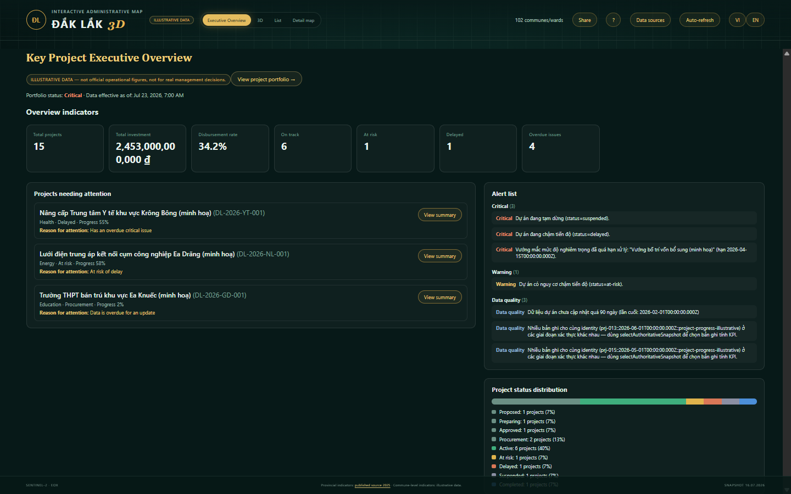
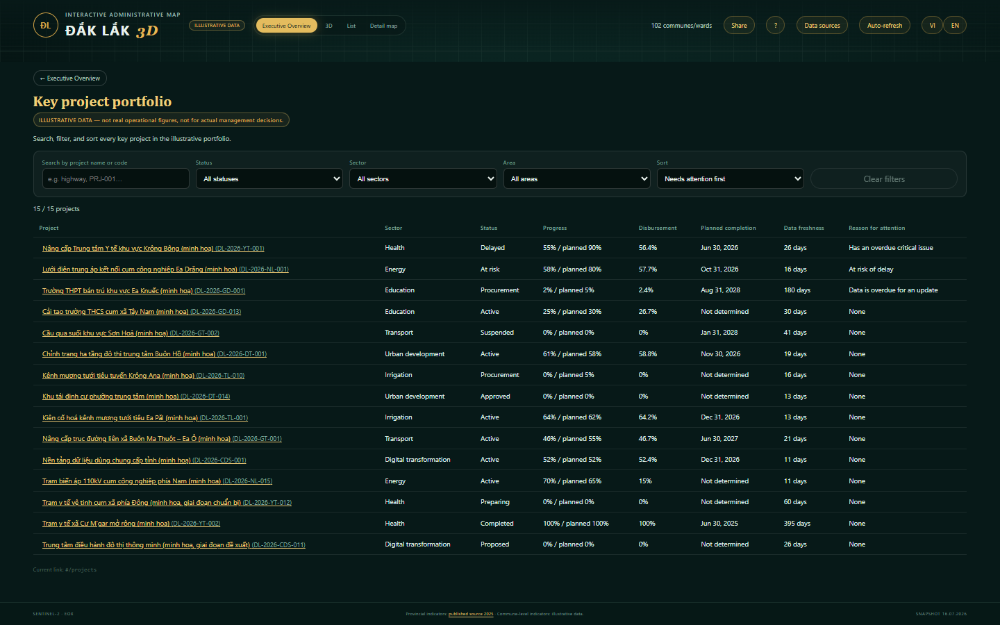
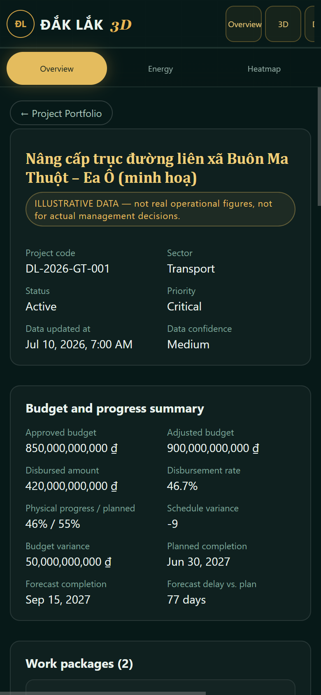
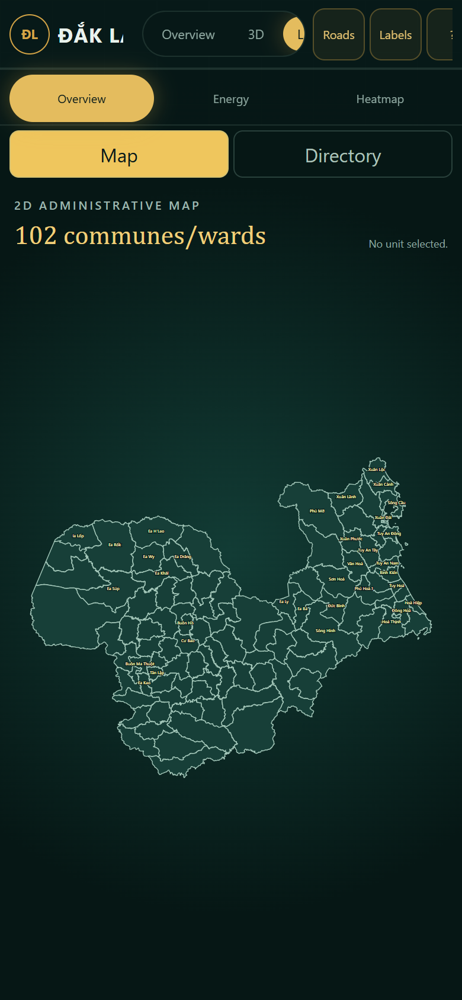
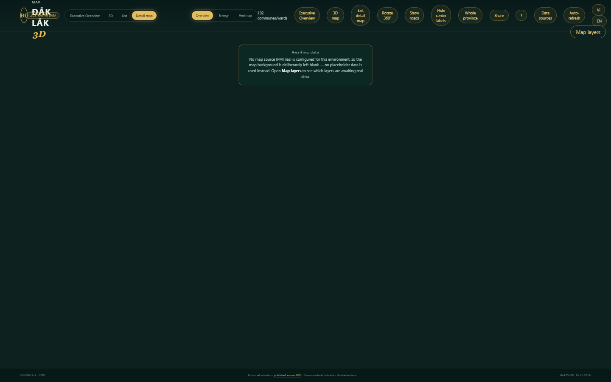

# Đắk Lắk 3D Dashboard

[](https://github.com/shadowhunter67/daklak-3d-dashboard/actions/workflows/quality.yml)
[](https://github.com/shadowhunter67/daklak-3d-dashboard/actions/workflows/deploy-pages.yml)
[](LICENSE)

[Tiếng Việt](README.md) (primary, most complete) · **English** (this file — a summary, not a full translation)

A WebGL dashboard for the 102 communes/wards of Đắk Lắk province after the 2025 administrative
merger (former Đắk Lắk highlands plus former Phú Yên coast), combined with a project-tracking
platform. Beside the illustrative demo data it now carries **sourced real data**: 201 projects from
the 2026–2030 investment-attraction catalogue (Decision 1985/QĐ-UBND), profiles of all 102
communes/wards, 28 verified tourist destinations, and the planning documents cited in the
catalogue. The rule throughout: **no source means "No data yet" — never an invented number.**

The sidebar has: **Overview · Map · 3D map · Projects · Communes/wards · Tourism · Planning ·
Data & sources · Reports**, and the top search finds communes/wards, projects, catalogue entries,
tourist places and planning documents.

- **Executive Overview** (default) — status hero, plain-language alerts, KPIs and status chart
  (illustrative data), a locator map where all 102 names are drawn with zero overlaps, plus two
  real-data blocks: **Needs attention** (real data gaps: projects without a capital figure,
  projects needing planning review, communes without a photo) and **Capital scale by sector**
  (expected capital from Decision 1985, explicitly not disbursed capital). The accountability
  block only states why it is not shown: no published source names investors or disbursement.
- **Detail map** (`?view=map`, MapLibre GL JS + self-hosted PMTiles, no Google Maps) — all 102
  names always visible, overlaps displaced with leader lines; a **Lens** group (Executive /
  Investment / Tourism / Planning) switches the matching reference layers, and a **Tourism layer**
  shows sourced destinations (popup with a source link, no visitor counts).
- **3D map** — terrain from SRTM + Sentinel-2.
- **Communes/wards** — accessible 2D list and a **per-unit profile** (`#/unit/<code>`): area,
  2025 population, density, sub-units, investment projects and tourist places inside the unit.
  14/102 units show a photo of a tourist destination located inside them (free licence, author
  credited, labelled as not an overview of the unit); the rest show the GIS boundary shape and say so.
- **Projects** — illustrative portfolio/detail (CSV export) and the real **investment-attraction
  catalogue** (`#/investment-catalog`, 201 projects with per-field source, date and evidence level).
- **Tourism** (`#/tourism`) — 28 sourced destinations, 25 with free-licence photos, the commune/
  ward containing each (derived from coordinates, labelled as derived); visitors = "No data yet".
- **Planning** (`#/planning`) — 118 planning documents cited in the catalogue with issuing body
  (inferred from the document number) and the spelling used in the source; projects whose own
  planning cell states a gap are flagged "needs review", **not a legal finding**; the planning
  layer on the map is labelled illustrative.
- **Explore** (`?view=world`, paused) — fly/walk over terrain with the 28 sourced destinations and
  per-destination 3D dioramas; see [reports/tourism-digital-twin/phase-status.md](reports/tourism-digital-twin/phase-status.md).

**Known limits:** 88/102 units have no photo (photos from the press/UBND need permission; draft
letter in [reports/research/permission-request-draft.md](reports/research/permission-request-draft.md));
label overlap is unverified on the 3D and detail maps (needs a real GPU); no published source for
visitor counts, investors/disbursement or official planning boundaries; planning document numbers
are regex-extracted and not yet checked against the originals; 4 capital groups in Decision 1985
differ from their group totals. Full status: [reports/v3-upgrade/final-report.md](reports/v3-upgrade/final-report.md).

## Demo

**Live demo:** https://shadowhunter67.github.io/daklak-3d-dashboard/

> **Disclaimer — two kinds of data, kept separate in the UI:** Executive Overview KPIs, the sample
> project portfolio (9 projects), commune-level indicators and the coloured planning layer are
> **deterministic illustrative data** (fixed seed), not operational or official figures. The
> investment-attraction catalogue, unit profiles, tourist destinations and cited planning documents
> are **sourced real data** with per-item source and confidence; what has no source is shown as
> "No data yet". The map is a reference visualization, not a legal record for land, surveying,
> planning, or administrative boundary purposes. See
> [reports/research/source-quality-review.md](reports/research/source-quality-review.md).

## Accessibility

The design targets older and low-vision readers: enlarged base type across the header, KPI grid and
overview copy, an **A− / A / A+** font-scale control in the header (persisted across visits via
`localStorage`), status conveyed with text labels and not colour alone, and large VND amounts shown
as "… tỷ ₫" with the exact figure kept in the tooltip and screen-reader label. Automated Playwright
tests assert zero card/panel/button overlap and no horizontal overflow across six viewports
(320–1920px). See [docs/accessibility.md](docs/accessibility.md).

## Language / Internationalization

The UI supports **Vietnamese** (default) and **English**, switchable via the "VI / EN" control at
the top-right of the header — no page reload. The choice is reflected in a shareable URL
(`?lang=vi`/`?lang=en`, composable with any `?view=`/`#/projects...`) and remembered via
`localStorage`; Back/Forward correctly undoes/redoes the most recent language switch. See
[ADR 0003](docs/adr/0003-internationalization.md) for the full design.

**Currently translated:** the entire product — app shell, header, Executive Overview, Project
Portfolio, Project Detail, the 3D map controls, the accessible 2D directory, the MapLibre detail
map (layer panel, base map selector, local search, distance measurement), the onboarding tour, the
Data Sources panel, and the data provenance/quality dialog. A static audit
(`scripts/check_i18n_hardcoded_strings.mjs`, run in `npm test`) fails the build if any hard-coded
Vietnamese UI string appears outside the translation dictionary, so this can't silently regress.

**Deliberately still Vietnamese-only, by design, never a bug:** proper nouns (place names, project
names/codes from the illustrative fixture data), and any third-party/source content that has no
English variant yet (e.g. a dataset's `title`/`description` sourced from a Vietnamese-only
publisher document — see `resolveLocalizedText` in `src/i18n/`, which shows a small "Vietnamese
source text" note in that case rather than a broken or half-translated sentence).

## Screenshot

<p align="center">
  
</p>
<p align="center">
  
</p>
<p align="center">
  
  
</p>
<p align="center">
  
</p>
<p align="center"><sub>Every other screenshot in <a href="README.md">README.md</a> is in Vietnamese, the app's default language — these five show the same views switched to English.</sub></p>

## Running the project

Requires Node.js 22. GIS artifacts are already committed, so a frontend-only contributor does not
need Python:

```bash
npm ci
npm run dev
```

Full quality gate (lint, format, typecheck, unit tests, build, budget, production E2E, plus Python
GIS validation):

```bash
npm run quality
```

See [CONTRIBUTING.md](CONTRIBUTING.md#command-reference) for the complete command reference and
[scripts/README.md](scripts/README.md) for GIS rebuild instructions — not duplicated here to avoid
the files drifting apart.

## Licensing

This repository is **open source under the MIT License** (see [LICENSE](LICENSE)): use, copy,
modify, merge, publish, distribute, sublicense, and/or sell copies of the software are all
permitted, subject to inclusion of the copyright notice.

The project briefly moved to a Source-Available Evaluation License and has since reverted to MIT —
see [LICENSE-HISTORY.md](LICENSE-HISTORY.md) for the full history. Third-party dependencies and data
(OpenStreetMap, Sentinel-2, SRTM, `vietnamese-provinces-database`, ...) keep their own licenses
regardless of this repository's license — see [THIRD_PARTY_NOTICES.md](THIRD_PARTY_NOTICES.md) and
[ATTRIBUTION.md](ATTRIBUTION.md).

## Technical documentation

See the [`docs/`](docs/) folder for architecture, testing, performance, accessibility, data-platform,
and ADR documents — maintained in one place to avoid duplication/drift between the two READMEs.
