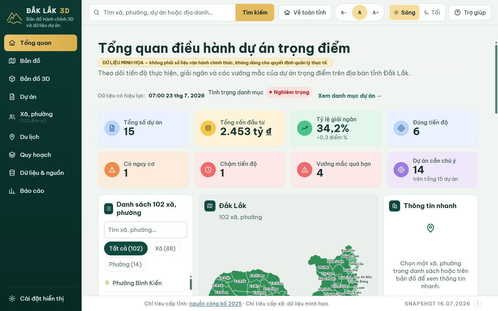
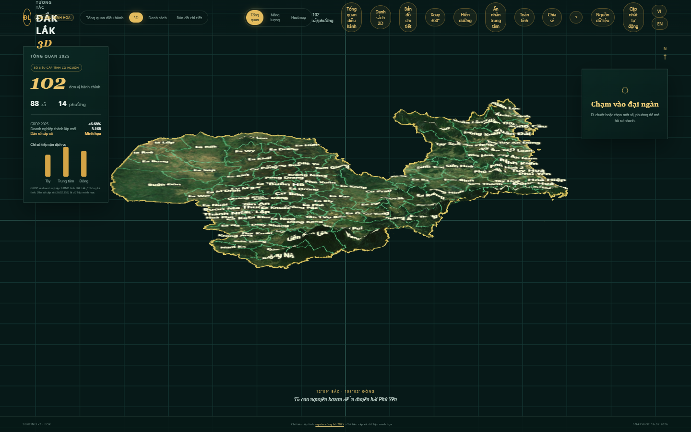
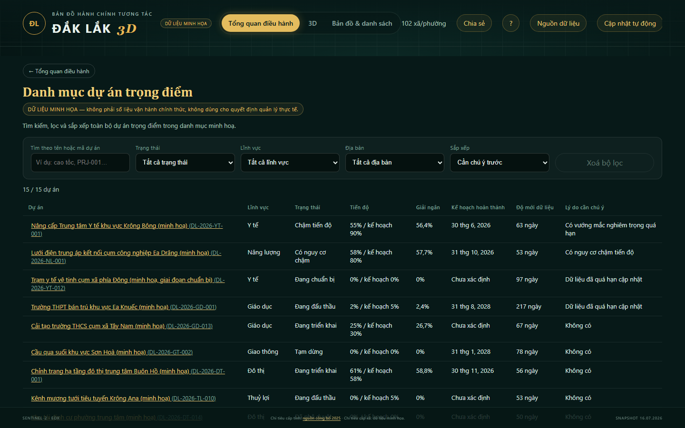
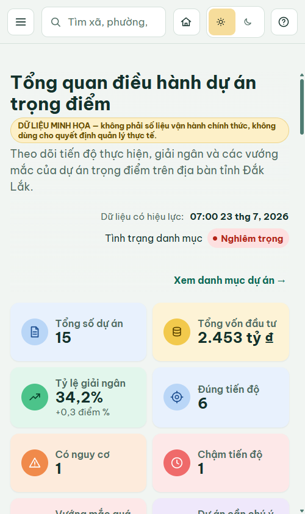
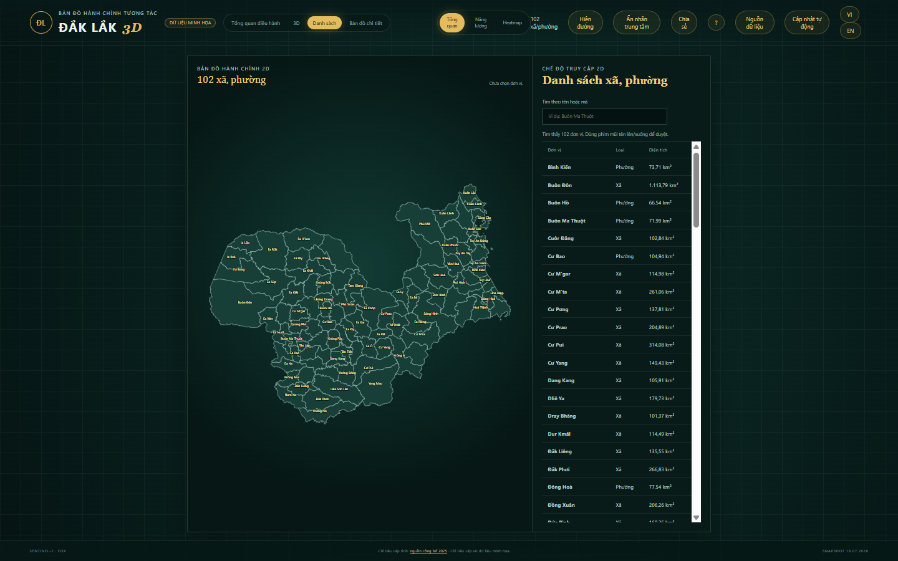

# Đắk Lắk 3D Dashboard

[](https://github.com/shadowhunter67/daklak-3d-dashboard/actions/workflows/quality.yml)
[](https://github.com/shadowhunter67/daklak-3d-dashboard/actions/workflows/deploy-pages.yml)
[](LICENSE)

**Tiếng Việt** (chính) · [**English**](README.en.md)

Dashboard bản đồ 3D thể hiện 102 xã/phường của tỉnh Đắk Lắk sau sáp nhập năm 2025, kết hợp một nền tảng theo dõi dự án đầu tư của tỉnh. Ngoài phần trình diễn bằng dữ liệu minh họa, ứng dụng đã có phần **dữ liệu thật có nguồn**: 201 dự án trong danh mục thu hút đầu tư 2026–2030 (Quyết định 1985/QĐ-UBND), hồ sơ 102 xã/phường, 28 điểm đến du lịch đã xác minh và các văn bản quy hoạch được trích dẫn. Nguyên tắc xuyên suốt: **chưa có nguồn thì ghi "Chưa có dữ liệu", không bịa số**.

## Xem thử

[](https://shadowhunter67.github.io/daklak-3d-dashboard/)

**Bản demo trực tuyến:** https://shadowhunter67.github.io/daklak-3d-dashboard/

> **Lưu ý về dữ liệu — hai loại được tách bạch trên giao diện:**
>
> - **Dữ liệu minh họa:** số liệu dự án/ngân sách/tiến độ trong phần **Tổng quan điều hành**, **Dự án** (danh mục 9 dự án mẫu) và chỉ tiêu cấp xã đều là dữ liệu minh họa, chỉ để trình diễn giao diện, không phải số liệu vận hành hay chính thức. Lớp quy hoạch tô màu trên bản đồ cũng là minh họa.
> - **Dữ liệu thật có nguồn:** danh mục thu hút đầu tư (201 dự án), hồ sơ xã/phường, điểm đến du lịch, văn bản quy hoạch được trích dẫn. Mỗi mục kèm nguồn và mức độ tin cậy; phần chưa có nguồn (lượt khách, chủ đầu tư, giải ngân…) được ghi rõ là chưa có dữ liệu.
>
> Ranh giới hành chính là dữ liệu mở tham khảo (đã đơn giản hóa), không dùng cho mục đích pháp lý/quy hoạch. Báo cáo chất lượng nguồn: [reports/research/source-quality-review.md](reports/research/source-quality-review.md).

## App có gì

Thanh bên gồm: **Tổng quan · Bản đồ · Bản đồ 3D · Dự án · Xã, phường · Du lịch · Quy hoạch · Dữ liệu & nguồn · Báo cáo**. Ô tìm kiếm chung ở trên cùng tìm được xã/phường, dự án, danh mục thu hút đầu tư, điểm du lịch và văn bản quy hoạch.

- **Tổng quan điều hành** — trang mặc định. Panel **Executive Status Hero** cho biết tình hình tổng thể (Ổn định/Cần chú ý/Nghiêm trọng) và số dự án cần xử lý trong vài giây; bên dưới là KPI danh mục (minh họa), cảnh báo bằng tiếng dễ hiểu, dự án cần chú ý, biểu đồ trạng thái, bản đồ định vị 102 xã/phường (mọi tên đều hiện, không nhãn nào chồng nhau) và hai khối dữ liệu thật: **Việc cần chú ý** (khoảng trống dữ liệu thật như dự án chưa có số vốn, dự án cần rà soát quy hoạch, xã chưa có ảnh) và **Quy mô vốn theo lĩnh vực** (vốn dự kiến trong Quyết định 1985, ghi rõ không phải vốn giải ngân). Khối trách nhiệm/giải ngân chỉ nêu lý do chưa hiển thị vì không có nguồn công bố.
- **Bản đồ (chi tiết)** — bản đồ MapLibre: ranh giới, đường giao thông, đo khoảng cách. Tên cả 102 xã/phường luôn hiển thị; nhãn chồng nhau được dịch ra và nối về vị trí thật bằng đường dẫn mảnh. Bảng lớp có nhóm **Góc nhìn** (Điều hành / Đầu tư / Du lịch / Quy hoạch) bật nhanh các lớp tham khảo tương ứng, cùng tab nhanh **Lớp du lịch** (điểm đến có nguồn, popup kèm link nguồn, không có số lượt khách). Hai mức **Cơ bản** và **Nâng cao** như trước.
- **Bản đồ 3D** — địa hình dựng từ dữ liệu vệ tinh thật (SRTM + Sentinel-2), xoay/phóng được, click xã để xem hồ sơ nhanh.
- **Xã, phường** — danh sách 2D dễ dùng (điều hướng bàn phím, trình đọc màn hình) và **hồ sơ từng đơn vị** (`#/unit/<mã>`): diện tích, dân số 2025, mật độ, số thôn/buôn/tổ dân phố, dự án thu hút đầu tư và điểm du lịch trong địa bàn. Ảnh đại diện hiện có cho 14/102 đơn vị (ảnh điểm đến du lịch trong địa bàn, giấy phép tự do, ghi rõ tác giả; không phải ảnh toàn cảnh); các đơn vị còn lại dùng hình ranh giới GIS và nói rõ điều đó.
- **Dự án** — hai phần: **Danh mục dự án** và **Chi tiết dự án** (ngân sách, tiến độ, gói thầu, vướng mắc; dữ liệu minh họa, có nút **Xuất CSV**), và **Danh mục thu hút đầu tư 2026–2030** (`#/investment-catalog`): 201 dự án thật từ Quyết định 1985/QĐ-UBND, lọc theo lĩnh vực/địa bàn, mỗi trường kèm văn bản nguồn, ngày và mức bằng chứng.
- **Du lịch** (`#/tourism`) — 28 điểm đến đã xác minh nguồn (thác, hồ, vườn quốc gia, tháp Chăm, di tích, địa danh ven biển…), lọc theo loại hình, mỗi thẻ có ảnh giấy phép tự do (25/28), link nguồn, xã/phường chứa điểm (suy ra từ tọa độ) và diorama 3D minh họa. Lượt khách ghi "Chưa có dữ liệu".
- **Quy hoạch** (`#/planning`) — 118 văn bản quy hoạch được trích dẫn trong danh mục thu hút đầu tư, kèm số dự án trích dẫn, cơ quan ban hành (suy từ số hiệu) và cách nguồn viết số hiệu; danh sách dự án mà chính ô nguồn nêu còn thiếu quy hoạch ("cần rà soát", **không phải kết luận pháp lý**); lớp quy hoạch trên bản đồ gắn nhãn minh họa.
- **Dữ liệu & nguồn** và **Báo cáo** — độ sẵn sàng dữ liệu (kể cả độ phủ ảnh xã/phường), nguồn gốc và chất lượng dữ liệu, báo cáo tổng hợp.
- **Khám phá** _(nền địa hình minh họa, dữ liệu điểm đến là thật, tạm dừng phát triển — chỉ vào được qua link trực tiếp `?view=world`)_ — đi bộ hoặc bay trên địa hình tỉnh, 28 điểm đến có nguồn, 3 tuyến tham quan. Xem [docs/world-exploration.md](docs/world-exploration.md) và [docs/destination-diorama.md](docs/destination-diorama.md).
- Giao diện có cả **tiếng Việt và tiếng Anh**, chuyển đổi ngay không cần tải lại trang.
- **Thiết kế ưu tiên dễ đọc** — cỡ chữ lớn, nút chỉnh cỡ chữ **A− / A / A+** (được ghi nhớ), trạng thái luôn kèm nhãn chữ, tên truy cập của nút chứa đúng chữ hiển thị (WCAG 2.5.3), kiểm tự động bằng axe. Xem [docs/accessibility.md](docs/accessibility.md).

### Giới hạn đã biết và việc đang tiếp tục

- **Ảnh xã/phường:** 88/102 đơn vị chưa có ảnh; ảnh từ báo/UBND cần giấy phép (bản nháp thư xin phép: [reports/research/permission-request-draft.md](reports/research/permission-request-draft.md)).
- **Nhãn bản đồ 3D và bản đồ chi tiết:** chưa kiểm chứng được không chồng nhãn (cần GPU thật); bản đồ định vị ở Tổng quan đã đo 0 chồng.
- **Thiếu nguồn công bố:** lượt khách du lịch, chủ đầu tư/giải ngân của dự án trong danh mục, ranh giới quy hoạch chính thức.
- **Chưa đối chiếu bản gốc:** số hiệu văn bản quy hoạch (trích bằng biểu thức chính quy) và 4 nhóm vốn trong Quyết định 1985 lệch tổng so với tiêu đề.
- **Phân cấp nhãn giữa nhiều loại nhãn** khi bật đồng thời nhiều lớp ở chế độ Nâng cao; **provenance passport** chi tiết hơn cho từng số liệu.

Báo cáo đầy đủ trạng thái V3: [reports/v3-upgrade/final-report.md](reports/v3-upgrade/final-report.md).

## Chạy thử trên máy

Cần Node.js 22.

```bash
npm ci
npm run dev
```

Muốn build thử bản production hoặc chạy kiểm tra chất lượng code, xem [CONTRIBUTING.md](CONTRIBUTING.md).

## Một vài ảnh minh họa

<p align="center">
  
  
</p>
<p align="center">
  
  
</p>

## Giấy phép

Mã nguồn dùng giấy phép **MIT** — xem [LICENSE](LICENSE). Dữ liệu/ảnh bên thứ ba (OpenStreetMap, Sentinel-2, SRTM...) giữ nguyên giấy phép riêng — xem [ATTRIBUTION.md](ATTRIBUTION.md).

## Muốn tìm hiểu sâu hơn?

Tài liệu kỹ thuật chi tiết (kiến trúc hệ thống, pipeline dữ liệu, các quyết định thiết kế...) nằm trong thư mục [`docs/`](docs/). Vài điểm bắt đầu hữu ích:

- [Kiến trúc hệ thống](docs/architecture.md)
- [Thuyết minh "Make in Viet Nam" (tính nguyên bản, công nghệ làm chủ, tiêu chuẩn áp dụng)](docs/make-in-vietnam.md)
- [Nguồn gốc và kiểm định dữ liệu](docs/data-provenance.md)
- [Hiệu năng và ngân sách](docs/performance.md)
- [Kiểm kê nguồn và chất lượng dữ liệu V3](reports/research/official-sources.md)
- [Khả năng tiếp cận](docs/accessibility.md)
- [Hướng dẫn đóng góp](CONTRIBUTING.md) và [chính sách bảo mật](SECURITY.md)
- [English documentation](README.en.md)
